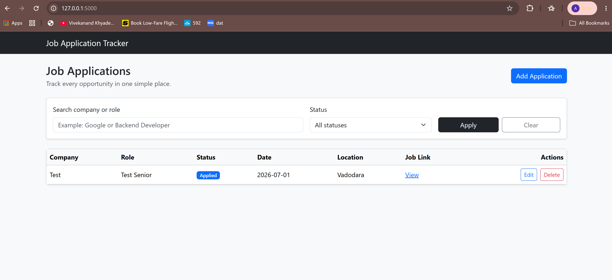
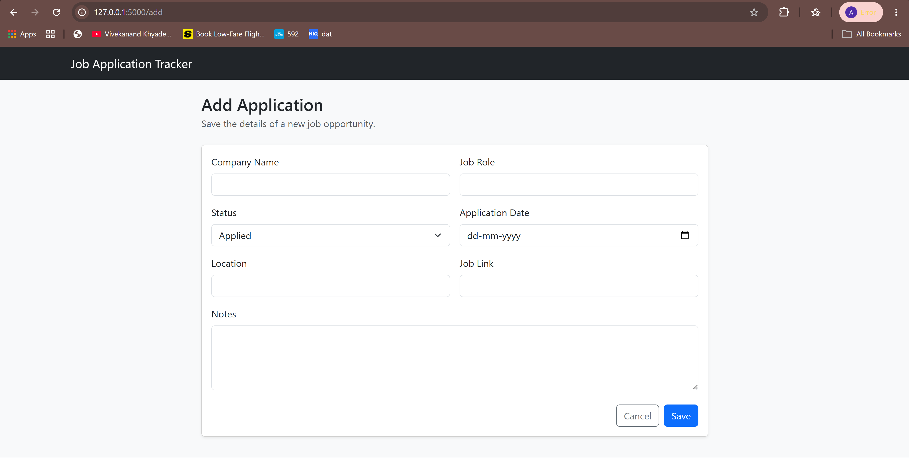
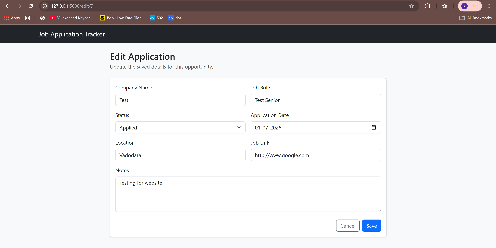

# Job Application Tracker

[](https://github.com/ayushgupta2056/Job-Application-Tracker/actions/workflows/tests.yml)

A FastAPI web app to keep track of job applications in one place.

**Live demo:** https://job-application-tracker-demo-xmoh.onrender.com
(sample data only; hosted on Render's free plan, so the first request after
15 minutes of inactivity can take up to a minute while the server wakes up)

I built this project to practice the main parts of a small backend web application: handling form submissions, storing data in SQLite, rendering pages with Jinja2, and testing the important flows with pytest.

## Features

- Add job applications
- View all saved applications
- Edit application details
- Delete applications with confirmation
- Search by company or job role
- Filter by status
- Use search and status filter together
- Show newest applications first
- Validate form input on the server
- Show success and error messages
- Handle missing pages and invalid records with custom error pages

## Tech Stack

| Area | Technology |
| --- | --- |
| Backend | Python, FastAPI, Uvicorn |
| Database | SQLite |
| Templates | Jinja2 |
| Frontend | HTML, CSS, Bootstrap 5 |
| Testing | pytest, FastAPI TestClient |

## Application Statuses

The app supports four application statuses:

- Applied
- Interview
- Rejected
- Selected

## Screenshots

### Homepage



### Add Application



### Edit Application



## Project Structure

```text
job-application-tracker/
|-- app.py
|-- jobs.db                 # created locally when the app runs
|-- requirements.txt
|-- render.yaml             # Render deployment for the live demo
|-- README.md
|-- .gitignore
|-- .github/workflows/tests.yml
|-- docs/
|   |-- PROJECT_AUDIT.md
|   `-- TEST_REPORT.md
|
|-- templates/
|   |-- base.html
|   |-- index.html
|   |-- add_job.html
|   |-- edit_job.html
|   |-- 404.html
|   `-- 500.html
|
|-- static/
|   `-- style.css
|
|-- screenshots/
|   |-- homepage.png
|   |-- add-application.png
|   `-- edit-application.png
|
`-- tests/
    |-- test_app.py
    `-- test_additional_coverage.py
```

## Database

The project uses SQLite through Python's built-in `sqlite3` module.

The database has one table: `applications`.

| Column | Description |
| --- | --- |
| id | Unique ID for each application |
| company | Company name |
| role | Job role |
| status | Current application status |
| application_date | Date of application |
| location | Job location |
| job_link | Link to the job posting |
| notes | Extra notes |
| created_at | When the record was created |
| updated_at | When the record was last updated |

The database file is created automatically when the app runs.

SQL queries use placeholders like `?` so user input is passed safely instead of being added directly into query strings.

## Routes

| Route | Method | Description |
| --- | --- | --- |
| `/` | GET | Shows the application list with search and filter options |
| `/add` | GET | Shows the add application form |
| `/add` | POST | Saves a new application |
| `/edit/{application_id}` | GET | Shows the edit form for an existing application |
| `/edit/{application_id}` | POST | Updates an existing application |
| `/delete/{application_id}` | POST | Deletes an application |

## Validation

The app validates form data in FastAPI before saving it to the database.

It checks that:

- Company name is not empty
- Job role is not empty
- Status is one of the allowed values
- Application date is provided and valid
- Job link is a valid `http://` or `https://` URL if entered

If validation fails, the app shows an error message and keeps the user's entered form values.

## Try the Live Demo

1. Open the live demo. Four sample applications are listed.
2. Click **Add Application**, fill in the form and save. A success message appears and the record is listed first.
3. Type a company or role in the search box, or pick a status, and click **Apply**.
4. Click **Edit** on a record, change the status and save.
5. Try saving with an empty company, a date like `2026-02-30`, or a job link like `example.com`. The form shows validation errors and keeps your input.
6. Open `/edit/99999` to see the custom 404 page.
7. **Reset demo data** in the yellow banner restores the four sample records.

## Setup

Open PowerShell in the project folder.

Install the required packages:

```powershell
pip install -r requirements.txt
```

Run the app:

```powershell
python app.py
```

Open this URL in the browser:

```text
http://127.0.0.1:5000
```

## Running Tests

Run all tests:

```powershell
python -m pytest
```

Run tests with detailed output:

```powershell
python -m pytest -v
```

The tests use a temporary SQLite database, so they do not change the real `jobs.db` file.

`tests/test_app.py` is the original suite (10 tests). `tests/test_additional_coverage.py`
was added later (21 test cases, including parametrized ones) for invalid dates and URLs,
custom 404/500 pages, combined search and filter, SQL-injection-style search input,
the empty state and demo mode. GitHub Actions runs both on every push.

The tests cover:

- Homepage loading
- Adding an application
- Editing an application
- Deleting an application
- Searching by company
- Searching by role
- Filtering by status
- Invalid ID handling
- Required field validation
- Invalid status validation

## Deployment

The live demo runs on Render using `render.yaml`:

```text
uvicorn app:app --host 0.0.0.0 --port $PORT --proxy-headers --forwarded-allow-ips="*"
```

`--proxy-headers` lets the app see that Render served the request over HTTPS, so links
generated with `url_for` use `https://`.

| Environment variable | Purpose |
| --- | --- |
| `DATABASE_PATH` | Optional path to the SQLite file (default: `jobs.db` next to `app.py`) |
| `DEMO_MODE=1` | Public demo only: seeds sample records, shows the demo banner and enables `POST /demo/reset` |

## Known Limitations

- Render's free plan has no persistent disk. `jobs.db` lives on temporary storage, so the
  demo returns to the sample records whenever the service restarts or redeploys.
  A real deployment would use a persistent disk or a hosted database such as PostgreSQL.
- There is no login, so everyone using the demo shares the same records.
- SQLite allows one writer at a time, which is fine for one user but not for heavy concurrent use.
- No pagination yet; every matching record is listed.

## Future Improvements

- Add pagination
- Add sorting options
- Add CSV export
- Add an archive option for old applications

## Resume Summary

Built a FastAPI and SQLite job application tracker with CRUD operations, search, filtering, server-side validation, custom error pages, Jinja2 templates, and pytest tests for the main application flows.
